<h1 align="center">Welcome to the Verse of Abhi</h1>

<i>A builder who never waited for the right machine, the right moment, or luck's permission — only for the people who believed, and the nights that refused to end.</i>

<b>📖 The full story — told in scenes, with music — lives on the portfolio:</b> 
<a href="https://muse.ai/s/github-portfolio-3d-xhy7lxexrd1qxyt/UpcVNHsGdAPXWclspfvsatwWf29eio-qlun4snCsbIE">https://muse.ai/s/github-portfolio-3d-xhy7lxexrd1qxyt/UpcVNHsGdAPXWclspfvsatwWf29eio-qlun4snCsbIE</a> 
GitHub is the trailer. The portfolio is the film. Both are cut from the same story, and each points to the other.

---

### The first two worlds

- **VidyaSathi** — the first spell, cast on a borrowed wand: one overnight build on a roommate's laptop, and by sunrise, a first victory on an American stage.
- **Monsoon Mitr** — the first ship of his own. At dawn, in the rice fields, his father held the camera.

### The flagships

| World | In one line | |
|---|---|---|
| **Abhiverse** | The universe itself — phone, laptop and tablet, one heartbeat across networks | [Live](https://msabhishek22.github.io/AbhiVerse/) · [Code](https://github.com/MSAbhishek22/AbhiVerse) |
| **Verity** | A research agent that shows its receipts — every claim, cited | [Live](https://verity-m-s-abhisheks-projects.vercel.app) · [Code](https://github.com/MSAbhishek22/verity) |
| **NyayaVault** | Legal documents, guarded like a vault ought to be | [Live](https://nyayavault-iota.vercel.app) · [Code](https://github.com/MSAbhishek22/nyayavault) |
| **ClaimLens** | Holds every claim up to the light before believing it | [Live](https://claimlens-mu.vercel.app) · [Code](https://github.com/MSAbhishek22/claimlens) |
| **Spec Ghost** | Turns whispered specs into haunted, working software | [Live](https://spec-ghost-green.vercel.app) · [Code](https://github.com/MSAbhishek22/spec-ghost) |
| **SchemeSathi** | Government schemes, translated into a friend's voice | [Live](https://schemesathi-kappa.vercel.app) · [Code](https://github.com/MSAbhishek22/schemesathi) |

Eighty-one repositories in all — the whole fleet sails on the <a href="https://muse.ai/s/github-portfolio-3d-xhy7lxexrd1qxyt/UpcVNHsGdAPXWclspfvsatwWf29eio-qlun4snCsbIE">portfolio</a>.

### The long drive

Every box is a day he showed up. This chart is drawn from his real GitHub history and redraws itself, daily.

---

<a href="https://www.linkedin.com/in/m-s-abhishek22">LinkedIn</a> ·
<a href="https://www.instagram.com/abhi.isglitched">Instagram</a> ·
<a href="https://x.com/MSAbhishek022">X</a> ·
<a href="mailto:msabhishekbdps@gmail.com">Email</a> ·
<a href="https://muse.ai/s/github-portfolio-3d-xhy7lxexrd1qxyt/UpcVNHsGdAPXWclspfvsatwWf29eio-qlun4snCsbIE">The Portfolio</a>

<i>The story continues where the code lives.</i>

