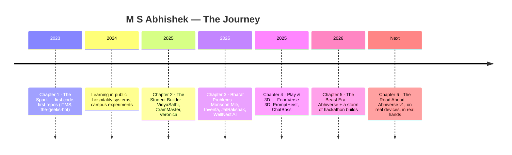

<!-- ============================================================
  M S ABHISHEK — @MSAbhishek22
  This is not a profile. This is a story.
  Theme: tokyonight everywhere. Updates: snake / pacman / 3D-city
  are regenerated daily by GitHub Actions in this repo.
============================================================ -->

 

> ### *"Nothing new. Just what was missing."*
> — the line every build of mine is judged by. If it already exists and works, I don't rebuild it. If it's missing and people feel that gap every day — that's my next repo.

---

# 📖 THE STORY SO FAR

---

## 🌑 CHAPTER 1 — THE SPARK *(2023–24)*

Every builder has an embarrassing first repo. Mine tried to manage **city traffic**.

I was a BTech CSE student at **Shobhit University, Meerut**, who had just discovered that code could touch the real world. So the first things I built weren't todo apps — they were an **Intelligent Traffic Management System** and a community bot. They were rough. They were unfinished in places. But they taught me the only lesson that matters:

> *"First, solve the problem. Then, write the code."* — John Johnson

| The first sparks | What they were |
|---|---|
| 🚦 **[ITMS](https://github.com/MSAbhishek22/ITMS)** | Intelligent Traffic Management — my first swing at a real-world system |
| 🤖 **[the-geeks-bot](https://github.com/MSAbhishek22/the-geeks-bot)** | A bot for my geek community — automation before I knew the word |
| 🏨 **[Digitalization of the Hospitality Process](https://github.com/MSAbhishek22/Digitalization-of-the-Hospitality-Process)** | Digitising hotel workflows — first taste of building for an actual industry |

---

## 🎓 CHAPTER 2 — THE STUDENT BUILDER *(2025)*

Then I started building for the people sitting next to me in class. Students drowning in PDFs, PYQs scattered across WhatsApp groups, exams arriving faster than notes.

- 📚 **[VidyaSathi](https://github.com/MSAbhishek22/vidyasathi)** — a student-driven platform with study material, previous-year questions, tutorials and a discussion forum in one clean place. *Built because I lived the chaos it fixes.*
- 🎓 **[CramMaster](https://github.com/MSAbhishek22/CramMaster)** — agentic AI study planning: multi-step workflows that turn panic into a personalised plan.
- 🗣️ **[Veronica](https://github.com/MSAbhishek22/Veronica_Chatbot)** — a voice-first AI chatbot (Groq + Flask + speech in/out). My first "talk to the machine" moment — a thread that runs through almost everything I build now.
- 📈 **[EduGraphIQ](https://github.com/MSAbhishek22/EduGraphIQ)** · **[EduPilot](https://github.com/MSAbhishek22/edupilot)** · **[TrackMate](https://github.com/MSAbhishek22/-TrackMate_Master-Your-Goals)** — the supporting cast of the student-tools era.

---

## 🇮🇳 CHAPTER 3 — BHARAT PROBLEMS *(2025–26)*

The turn that defined me: **stop building demos, start building for Bharat.** A farmer deciding whether to irrigate today. A kirana owner counting stock at midnight. A family that can't reach a doctor.

- 🌧️ **[Monsoon Mitr](https://github.com/MSAbhishek22/monsoon-mitra)** — weather intelligence for farmers, so one wrong irrigation decision doesn't burn a season's money.
- 🗣️🛒 **[Inventa](https://github.com/MSAbhishek22/Inventa)** — voice-enabled inventory for Indian kirana shops. *Bolke stock update karo* — because the owner's hands are full and the keyboard was never made for him.
- 💧 **[JalRakshak](https://github.com/MSAbhishek22/JalRakshak)** — guarding water, the resource every village argues about.
- 🧠 **[WellNest AI](https://github.com/MSAbhishek22/Wellnest-AI)** — a multi-agent wellness companion: mood, goals, mindful journaling, gentle nudges.
- 🏥 **[MedBridge](https://github.com/MSAbhishek22/MedBridge)** · 🚨 **[ALERTBRIDGE](https://github.com/MSAbhishek22/ALERTBRIDGE)** — health and emergency bridges, built long before "healthtech" became my hackathon home turf.

---

## 🎮 CHAPTER 4 — PLAY & 3D *(2025)*

A builder who never plays builds boring things. This was my playground era — and where the 3D obsession on this page comes from.

- 🌌 **[FoodVerse 3D](https://github.com/MSAbhishek22/foodverse-3d-health-explorer-1)** — foods as planets in an explorable 3D nutrition universe, with an AI nutritionist riding along.
- ⚔️ **[PromptHeist](https://github.com/MSAbhishek22/Promptheist-ai-battle-arena)** — a real-time arena where people battle by writing better prompts.
- 👹 **[ChatBoss](https://github.com/MSAbhishek22/chatboss-twitchcon)** — a Twitch chat boss-fight overlay: viewers type `!attack`, the boss bleeds, the boss hits back.
- 🎙️ **[VoiceBox](https://github.com/MSAbhishek22/VoiceBox)** · ⚡ **[Tap Duel](https://github.com/MSAbhishek22/Tap-Duel-)** — small, fast, fun.

---

## 🔥 CHAPTER 5 — THE BEAST ERA *(Oct–Nov 2026)*

Then came the storm. One flagship, and a fleet built around a single rule I now swear by: **deterministic core, AI on a short leash, proof over promises — every claim with a receipt.**

### 🌌 The Flagship — [Abhiverse](https://github.com/MSAbhishek22/AbhiVerse)

> **One open-source control centre for all your devices** — phone, laptop, tablet, across networks. Android controller first, Windows agent first, secure pairing, file transfer and remote desktop on the roadmap.
> 🔗 **Live:** https://msabhishek22.github.io/AbhiVerse/ · Stack: Flutter · Rust · Axum
> *Why it exists: every ecosystem locks you in. Your own devices should answer to you — nobody else.*

### ⚖️ Truth & Law — agents that show their receipts

| Build | The story in one line | Live |
|---|---|---|
| 🔍 **[Verity](https://github.com/MSAbhishek22/verity)** | A research agent that answers **with receipts** — groundedness scored 0–100, every claim cited (33/33 tests) | [▶ Live](https://verity-m-s-abhisheks-projects.vercel.app) · [🎥 Video](https://www.youtube.com/watch?v=27PTOpvSwFs) |
| ⚖️ **[NyayaVault](https://github.com/MSAbhishek22/nyayavault)** | Grounded legal research over **real Indian law** — Constitution, IT Act, CPA, Contract Act | [▶ Live](https://nyayavault-iota.vercel.app) · [🎥 Video](https://youtu.be/by4iPbj2i5w) |
| 🔎 **[ClaimLens](https://github.com/MSAbhishek22/claimlens)** | Holds claims up to the light — clean claims score ~95, poisoned ones get caught | [▶ Live](https://claimlens-mu.vercel.app) |

### 🏛️ Governance & Health — building for the last mile

| Build | The story in one line | Live |
|---|---|---|
| 🪔 **[SchemeSathi](https://github.com/MSAbhishek22/schemesathi)** | A Hinglish companion that walks citizens to the government schemes they're actually eligible for | [▶ Live](https://schemesathi-kappa.vercel.app) |
| 🧾 **[YojanaSetu](https://github.com/MSAbhishek22/yojanasetu)** | Beneficiary-data governance with a duplicate review queue — one citizen, one record | [▶ Live](https://yojanasetu-self.vercel.app) |
| 🏥 **[ClinicLink](https://github.com/MSAbhishek22/cliniclink)** | Clinic visit filing that respects privacy — synthetic data, approval-gated pairing | Repo |
| 🩺 **[OPD Triage Lens](https://github.com/MSAbhishek22/triage-lens)** | Hospital OPD triage, screened in seconds instead of queues | [▶ Live](https://opd-triage-lens.vercel.app) |

### 🛡️ Guardrails — AI you can actually trust

| Build | The story in one line |
|---|---|
| 🧰 **[CageCheck](https://github.com/MSAbhishek22/cagecheck)** | Check an agent's code **in a cage** before it touches your repo — also ported to QNX |
| 👻 **[Spec Ghost](https://github.com/MSAbhishek22/spec-ghost)** | Finds specs with no code, code with no spec, and stale specs pointing at deleted files — deterministic, no LLM |
| 🔐 **[SecretGate for Jira](https://github.com/MSAbhishek22/secretgate-jira)** | Scans for secrets before they leak into tickets and repos |
| 💳 **[Guarded Wallet](https://github.com/MSAbhishek22/near-guarded-wallet)** | An AI wallet with per-transaction caps, allowlists and an approval gate — generosity with brakes |
| 🧩 **[SpecGuard](https://github.com/MSAbhishek22/specguard)** | A VS Code coding agent on TrueForge where **nothing hits disk before your approval** — per-hunk diffs, undo, full review |

### 📝 The NoteVault Family — one idea, three battlefields

| Build | The twist | Live |
|---|---|---|
| 📓 **[NoteVault](https://github.com/MSAbhishek22/notevault)** | Local-first notes agent — your notes stay yours | Repo |
| 🇮🇳 **[NoteVault Bharat](https://github.com/MSAbhishek22/notevault-bharat)** | The ask-desk for Bharat's classrooms | [▶ Live](https://notevault-bharat.vercel.app) |
| 🔀 **[NoteVault Hybrid](https://github.com/MSAbhishek22/notevault-hybrid)** | On-device Gemini Nano first, cloud only when *you* ask | [▶ Live](https://notevault-hybrid.vercel.app) |

### 🌊 And the rest of the storm

🗳️ **[PollPulse](https://github.com/MSAbhishek22/pollpulse)** (#01 on vibeapps.dev) · 🚪 **[GateFlat](https://github.com/MSAbhishek22/gateflat)** ([▶ Live](https://gateflat.vercel.app/)) · ☕ **[ChaiTip](https://github.com/MSAbhishek22/chaitip)** (BCH tipping, mainnet) · ⛪ **[Grace Notes](https://github.com/MSAbhishek22/grace-notes)** · 🌅 **[GHAT TAK](https://ghat-tak.vercel.app)** — a cinematic Chhath homecoming, Delhi→Patna by sleeper coach, Sharda Sinha in the air · 🐝 **[BeeBridge](https://github.com/MSAbhishek22/BeeBridge)** + **[bee-memory-mcp](https://github.com/MSAbhishek22/bee-memory-mcp)**

> *"The best way to predict the future is to invent it."* — Alan Kay

---

## 🏙️ CHAPTER 6 — THE CITY I BUILT

Every green square below is a day I showed up. The buildings rise on their own — this skyline is regenerated by a robot every night.

<picture>
  <source media="(prefers-color-scheme: dark)" srcset="./profile-3d-contrib/profile-night-rainbow.svg">
  <source media="(prefers-color-scheme: light)" srcset="./profile-3d-contrib/profile-green-animate.svg">
  
</picture>

## 🐍 THE ARENA — MY CONTRIBUTIONS DON'T SURVIVE THE NIGHT

<picture>
  <source media="(prefers-color-scheme: dark)" srcset="https://raw.githubusercontent.com/MSAbhishek22/MSAbhishek22/output/github-contribution-grid-snake-dark.svg">
  <source media="(prefers-color-scheme: light)" srcset="https://raw.githubusercontent.com/MSAbhishek22/MSAbhishek22/output/github-contribution-grid-snake.svg">
  
</picture>

<picture>
  <source media="(prefers-color-scheme: dark)" srcset="https://raw.githubusercontent.com/MSAbhishek22/MSAbhishek22/output/pacman-contribution-graph-dark.svg">
  <source media="(prefers-color-scheme: light)" srcset="https://raw.githubusercontent.com/MSAbhishek22/MSAbhishek22/output/pacman-contribution-graph.svg">
  
</picture>

---

## 🛠️ THE ARSENAL

### Languages I speak to machines in

### Frameworks & tools I ship with

---

## 📊 THE GRIND — LIVE NUMBERS

 

## 🏆 THE TROPHY CABINET

---

## 🚀 CHAPTER 7 — THE ROAD AHEAD

- 🌌 **Abhiverse v1** — real phone ↔ real laptop, pairing to remote desktop, in real hands
- 🎙️ **Voice-first Bharat** — the Veronica thread, grown up: products you talk to, in the language you think in
- 🏆 **The mission stays the same:** build things that were missing, prove they work, ship in public

**Open to:** collaborations, hackathon teams, startup conversations, and anyone building for Bharat.
📫 **Fastest way to reach me:** [msabhishekbdps@gmail.com](mailto:msabhishekbdps@gmail.com) · [LinkedIn](https://www.linkedin.com/in/m-s-abhishek22)

---

### ⭐ If a chapter here helped you, star the repo it lives in — that's how the story spreads.

