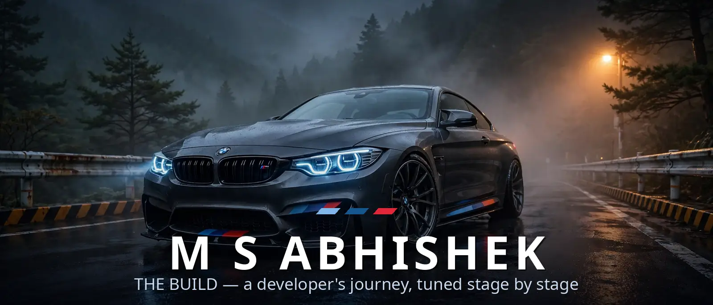
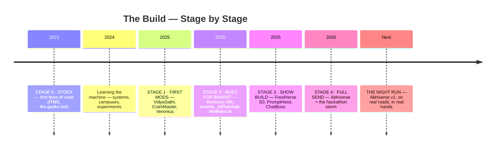
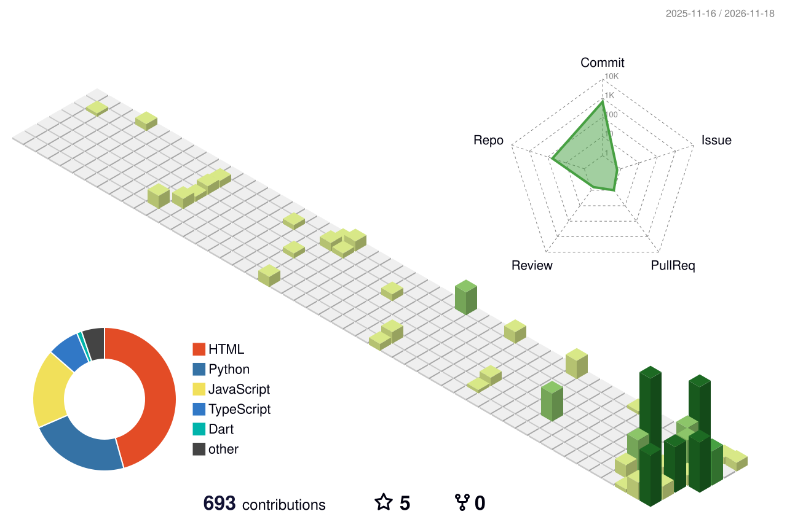

<!-- ============================================================
  M S ABHISHEK — @MSAbhishek22 · THE BUILD
  A developer's journey, told like a car build:
  stock → tuned → full send. Theme: ///M tricolour on asphalt.
  Banner: a night touge run — angel eyes on, mist up, road wet.
  Snake / Pac-Man / 3D city regenerate daily via Actions.
============================================================ -->

 

> ### *"Nothing new. Just what was missing."*
> — the line every build of mine is judged by. A car guy doesn't mod for decoration. Every part on this page exists because the stock version wasn't enough.

---

## 🏁 THE DRIVER

They call him **Sarfira** — a little crazy, fully committed. The papers say **M S Abhishek**.

Honest bio: he never fell in love with code. He fell in love with **the race** — the team forming at midnight, the demo that has to work by dawn, the room holding its breath. Code is just the engine; he'd rather be the one reading the road. His real bosses were never judges — they were **luck and money**: races lost before the start line because the entry, the travel, the resources weren't there, and friends quietly paying his bills so he never felt left out. He owes this garage to them — family first, then Aayushi, Chhavi, Rajnish, Rashtrapati, Jay Prakash, Bhavya, Adrika, Piyush, and Ashish, Khushi, Abhay, Anurag. Everything here was learned from people and from stubbornness — nobody handed it to him.

**His one rule:** *"It takes nothing to be kind. Give your best, serve your duties before yourself, and have faith — God has plans beyond your imagination."*

**His taste:** Harry Potter and Pirates of the Caribbean, Iron Man, Alan Walker and Atif Aslam at full volume, PUBG nights, a Continental GT 650 under him and a BMW M5 on the horizon.

**Where the road ends:** not fame. Freedom. Responsibilities fulfilled, then disappearing into the hills to run a small aesthetic café nobody can quite place. The best temporary person you ever met — then gone, like taillights into a hairpin.

---

# 🏁 THE BUILD LOG

Nobody builds a machine in a day. You start stock, you learn the machine, you tune it stage by stage — and one night it all comes together on an empty mountain road. My journey as a developer is the same story:

---

## 🔩 STAGE 0 — STOCK *(2023–24)*

Every build starts as a stock machine and a driver who doesn't know its limits yet. Mine was a fresher in Meerut who picked CSE–AI/ML *despite hating maths* — irony at its peak — a chill guy who loved managing and hosting events far more than line-by-line code, and who didn't even own a laptop. Then he found hackathons: the one place where management, people and building collide at 3 AM. That was the spark. My first "mods" weren't todo apps, they were swings at the real world:

| The first machine | What it was |
|---|---|
| 🚦 **[ITMS](https://github.com/MSAbhishek22/ITMS)** | Intelligent Traffic Management — a first-year trying to run a city's traffic |
| 🤖 **[the-geeks-bot](https://github.com/MSAbhishek22/the-geeks-bot)** | A bot for my geek community — automation before I knew the word |
| 🏨 **[Digitalization of the Hospitality Process](https://github.com/MSAbhishek22/Digitalization-of-the-Hospitality-Process)** | Hotel workflows, digitised — first taste of building for an industry |

> *"First, solve the problem. Then, write the code."* — John Johnson

---

## 🔧 STAGE 1 — FIRST MODS *(2025)*

Then I started tuning for the people next to me in class — students drowning in PDFs, PYQs scattered across WhatsApp groups, exams arriving faster than notes.

- 📚 **[VidyaSathi](https://github.com/MSAbhishek22/vidyasathi)** — study material, previous-year questions, tutorials and a forum in one clean garage. *The build I'll never forget: no laptop of my own, so I borrowed my roommate Jay Prakash's — games, a round of Maggi, then building from 1 AM to a 6 AM deadline. It won me my first hackathon, an American one. First trophy, borrowed machine.*
- 🎓 **[CramMaster](https://github.com/MSAbhishek22/CramMaster)** — agentic AI study planning: panic in, plan out.
- 🗣️ **[Veronica](https://github.com/MSAbhishek22/Veronica_Chatbot)** — a voice-first AI chatbot (Groq + Flask + speech in/out). My first "talk to the machine" moment — a thread that runs through everything since.
- 📈 **[EduGraphIQ](https://github.com/MSAbhishek22/EduGraphIQ)** · **[EduPilot](https://github.com/MSAbhishek22/edupilot)** · **[TrackMate](https://github.com/MSAbhishek22/-TrackMate_Master-Your-Goals)** — the supporting mods of the student era.

---

## 🛣️ STAGE 2 — BUILT FOR BHARAT'S ROADS *(2025–26)*

The tune that defined the build: **stop making garage queens, start making machines that survive real Indian roads.** A farmer deciding whether to irrigate today. A kirana owner counting stock at midnight. A family that can't reach a doctor.

- 🌧️ **[Monsoon Mitr](https://github.com/MSAbhishek22/monsoon-mitra)** — weather intelligence for farmers, so one wrong irrigation call doesn't burn a season. *The first build on my OWN laptop (third year — until then, every machine was borrowed from friends). For the demo video, my father woke up at dawn and came with me to the rice fields to shoot it. This one's family.*
- 🗣️🛒 **[Inventa](https://github.com/MSAbhishek22/Inventa)** — voice-enabled inventory for kirana shops. *Bolke stock update karo* — the owner's hands are full; the keyboard was never made for him.
- 💧 **[JalRakshak](https://github.com/MSAbhishek22/JalRakshak)** — guarding water, the resource every village argues about.
- 🧠 **[WellNest AI](https://github.com/MSAbhishek22/Wellnest-AI)** — a multi-agent wellness companion: mood, goals, mindful journaling, gentle nudges.
- 🏥 **[MedBridge](https://github.com/MSAbhishek22/MedBridge)** · 🚨 **[ALERTBRIDGE](https://github.com/MSAbhishek22/ALERTBRIDGE)** — health and emergency bridges, long before healthtech became my home turf.

---

## ✨ STAGE 3 — THE SHOW BUILD *(2025)*

Every builder needs one stage that's pure joy — stance, shine, and a little show-off. This was mine, and it's where the 3D obsession comes from.

- 🌌 **[FoodVerse 3D](https://github.com/MSAbhishek22/foodverse-3d-health-explorer-1)** — foods as planets in an explorable 3D nutrition universe.
- ⚔️ **[PromptHeist](https://github.com/MSAbhishek22/Promptheist-ai-battle-arena)** — a real-time arena where people battle by writing better prompts.
- 👹 **[ChatBoss](https://github.com/MSAbhishek22/chatboss-twitchcon)** — a Twitch boss-fight overlay: chat types `!attack`, the boss bleeds, the boss hits back.
- 🎙️ **[VoiceBox](https://github.com/MSAbhishek22/VoiceBox)** · ⚡ **[Tap Duel](https://github.com/MSAbhishek22/Tap-Duel-)** — small, fast, fun.

---

## 🚀 STAGE 4 — FULL SEND *(Oct–Nov 2026)*

Then the limiter came off. One flagship machine, and a whole fleet built on a single rule: **deterministic core, AI on a short leash, proof over promises — every claim with a receipt.**

### 🌌 The Flagship Machine — [Abhiverse](https://github.com/MSAbhishek22/AbhiVerse)

> **One open-source control centre for all your devices** — phone, laptop, tablet, across networks. Android controller first, Windows agent first, secure pairing, file transfer and remote desktop on the roadmap.
> 🔗 **Live:** https://msabhishek22.github.io/AbhiVerse/ · Drivetrain: Flutter · Rust · Axum
> *Why it exists: every ecosystem locks you in. Your own devices should answer to you — nobody else.*

### 🏎️ THE GARAGE — the fleet

**Truth & Law division** — agents that show their receipts

| Machine | The story in one line | Pit lane |
|---|---|---|
| 🔍 **[Verity](https://github.com/MSAbhishek22/verity)** | Research agent that answers **with receipts** — groundedness 0–100, every claim cited (33/33 tests) | [▶ Live](https://verity-m-s-abhisheks-projects.vercel.app) · [🎥 Video](https://www.youtube.com/watch?v=27PTOpvSwFs) |
| ⚖️ **[NyayaVault](https://github.com/MSAbhishek22/nyayavault)** | Grounded legal research over **real Indian law** — Constitution, IT Act, CPA, Contract Act | [▶ Live](https://nyayavault-iota.vercel.app) · [🎥 Video](https://youtu.be/by4iPbj2i5w) |
| 🔎 **[ClaimLens](https://github.com/MSAbhishek22/claimlens)** | Holds claims up to the light — clean ones score ~95, poisoned ones get caught | [▶ Live](https://claimlens-mu.vercel.app) |

**Last-Mile division** — governance & health

| Machine | The story in one line | Pit lane |
|---|---|---|
| 🪔 **[SchemeSathi](https://github.com/MSAbhishek22/schemesathi)** | Hinglish companion that walks citizens to the schemes they're actually eligible for | [▶ Live](https://schemesathi-kappa.vercel.app) |
| 🧾 **[YojanaSetu](https://github.com/MSAbhishek22/yojanasetu)** | Beneficiary-data governance with a duplicate review queue — one citizen, one record | [▶ Live](https://yojanasetu-self.vercel.app) |
| 🏥 **[ClinicLink](https://github.com/MSAbhishek22/cliniclink)** | Clinic visit filing that respects privacy — synthetic data, approval-gated pairing | Repo |
| 🩺 **[OPD Triage Lens](https://github.com/MSAbhishek22/triage-lens)** | Hospital OPD triage in seconds instead of queues | [▶ Live](https://opd-triage-lens.vercel.app) |

**Roll-Cage division** — guardrails, because full send needs brakes

| Machine | The story in one line |
|---|---|
| 🧰 **[CageCheck](https://github.com/MSAbhishek22/cagecheck)** | Check an agent's code **in a cage** before it touches your repo — also ported to QNX |
| 👻 **[Spec Ghost](https://github.com/MSAbhishek22/spec-ghost)** | Finds specs with no code, code with no spec, stale specs pointing at deleted files — deterministic, no LLM |
| 🔐 **[SecretGate for Jira](https://github.com/MSAbhishek22/secretgate-jira)** | Scans for secrets before they leak into tickets and repos |
| 💳 **[Guarded Wallet](https://github.com/MSAbhishek22/near-guarded-wallet)** | An AI wallet with per-transaction caps, allowlists and an approval gate |
| 🧩 **[SpecGuard](https://github.com/MSAbhishek22/specguard)** | VS Code coding agent on TrueForge — **nothing hits disk before your approval**, per-hunk diffs, undo |

**The NoteVault family** — one idea, three terrains

| Machine | The twist | Pit lane |
|---|---|---|
| 📓 **[NoteVault](https://github.com/MSAbhishek22/notevault)** | Local-first notes agent — your notes stay yours | Repo |
| 🇮🇳 **[NoteVault Bharat](https://github.com/MSAbhishek22/notevault-bharat)** | The ask-desk for Bharat's classrooms | [▶ Live](https://notevault-bharat.vercel.app) |
| 🔀 **[NoteVault Hybrid](https://github.com/MSAbhishek22/notevault-hybrid)** | On-device Gemini Nano first, cloud only when *you* ask | [▶ Live](https://notevault-hybrid.vercel.app) |

**Also in the fleet:** 🗳️ **[PollPulse](https://github.com/MSAbhishek22/pollpulse)** (#01 on vibeapps.dev) · 🚪 **[GateFlat](https://github.com/MSAbhishek22/gateflat)** ([▶ Live](https://gateflat.vercel.app/)) · ☕ **[ChaiTip](https://github.com/MSAbhishek22/chaitip)** (BCH tipping, mainnet) · ⛪ **[Grace Notes](https://github.com/MSAbhishek22/grace-notes)** · 🌅 **[GHAT TAK](https://ghat-tak.vercel.app)** — a cinematic Chhath homecoming, Delhi→Patna by sleeper coach · 🐝 **[BeeBridge](https://github.com/MSAbhishek22/BeeBridge)** + **[bee-memory-mcp](https://github.com/MSAbhishek22/bee-memory-mcp)**

> *"The best way to predict the future is to invent it."* — Alan Kay
> *"The machine is only as fast as the hands on the wheel."*

---

## 🌃 THE CITY CIRCUIT — MY CONTRIBUTION SKYLINE AT NIGHT

Every green square is a day I showed up. The skyline rebuilds itself every night while I sleep — like a city that only exists because someone keeps driving through it.

<picture>
  <source media="(prefers-color-scheme: dark)" srcset="./profile-3d-contrib/profile-night-rainbow.svg">
  <source media="(prefers-color-scheme: light)" srcset="./profile-3d-contrib/profile-green-animate.svg">
  
</picture>

## 🐍 THE RACING LINE

A snake traces the perfect line through my contribution graph, corner after corner. Below it, Pac-Man runs the same circuit like it's 2 AM and the pass is empty.

<picture>
  <source media="(prefers-color-scheme: dark)" srcset="https://raw.githubusercontent.com/MSAbhishek22/MSAbhishek22/output/github-contribution-grid-snake-dark.svg">
  <source media="(prefers-color-scheme: light)" srcset="https://raw.githubusercontent.com/MSAbhishek22/MSAbhishek22/output/github-contribution-grid-snake.svg">
  
</picture>

<picture>
  <source media="(prefers-color-scheme: dark)" srcset="https://raw.githubusercontent.com/MSAbhishek22/MSAbhishek22/output-pacman/pacman-contribution-graph-dark.svg">
  <source media="(prefers-color-scheme: light)" srcset="https://raw.githubusercontent.com/MSAbhishek22/MSAbhishek22/output-pacman/pacman-contribution-graph.svg">
  
</picture>

---

## 📋 SPEC SHEET

| Part | Spec |
|---|---|
| **Engine** | Python · TypeScript · JavaScript · Dart · Rust |
| **ECU (the brains)** | AI agents · grounded RAG · deterministic cores with the LLM on a short leash |
| **Drivetrain** | Flutter · React / Next.js · FastAPI · Axum |
| **Suspension** | Firebase · Supabase · Vercel · Netlify — tuned for rough roads and low-end phones |
| **Brakes** | Tests before claims — 33/33, 25/25, 23/23 are numbers I publish, not vibes |
| **Fuel** | Hackathons. Lots of hackathons. |

### Full parts catalogue

---

## 📊 TELEMETRY — LIVE FROM THE DASHBOARD

 

## 🏆 THE PODIUM

---

## 🌌 THE NIGHT RUN AHEAD

- 🌌 **Abhiverse v1** — real phone ↔ real laptop, pairing to remote desktop, in real hands
- 🎙️ **Voice-first Bharat** — the Veronica thread, grown up: products you talk to, in the language you think in
- 🏁 **The rule stays the same:** build what was missing, prove it works, ship it in public — then drive it like you stole it

**Open to:** collaborations, hackathon teams, startup conversations, and anyone building for Bharat.
📫 **Fastest way to reach me:** [msabhishekbdps@gmail.com](mailto:msabhishekbdps@gmail.com) · [LinkedIn](https://www.linkedin.com/in/m-s-abhishek22)

---

### ⭐ If a machine in this garage helped you, star it — that's how the fleet grows.

